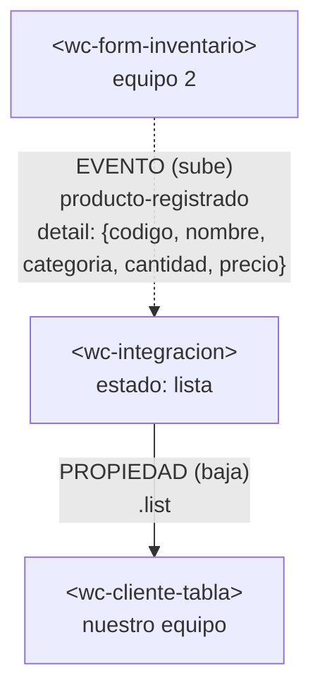

# Integración con el componente de otro equipo

## 1. Datos

| Campo | Valor |
|---|---|
| Equipo | Equipo 1 · Grupo 1 · Gestión de clientes |
| Equipo externo | Equipo 2 · Grupo 2 · Inventario |
| Repositorio externo | https://github.com/DaniAleG/app-lit |
| Archivo externo | `src/views/inventario/form-inventario.js` → copiado en `src/externos/equipo-2/form-inventario.js` |
| Commit usado | `1c8417f` |

## 2. Componentes y roles

| Componente | Archivo | Origen | Rol |
|---|---|---|---|
| `<wc-integracion>` | `src/views/integracion/integracion.js` | Nuestro equipo | **Padre**. Dueño del estado `lista`. |
| `<wc-form-inventario>` | `src/externos/equipo-2/form-inventario.js` | Equipo 2 | **Hijo**. Emite el evento `producto-registrado`. |
| `<wc-cliente-tabla>` | `src/components/clientes/cliente-tabla.js` | Nuestro equipo | **Hijo**. Recibe la lista por la propiedad `list`. |

## 3. Flujo de comunicación



Los datos bajan por propiedades y los eventos suben. El formulario del Equipo 2 no conoce la tabla; solo avisa con un evento y `<wc-integracion>` decide qué hacer con el dato.

## 4. Adaptador

El formulario del Equipo 2 emite un producto con `{codigo, nombre, categoria, cantidad, precio}`; nuestra tabla espera un cliente con `{name, lastName, email, age}`. Como no se puede modificar el componente externo ni conviene cambiar la tabla, el adaptador vive en `<wc-integracion>`, en el método `agregar`.

```js
agregar(evento) {
  const producto = evento.detail ?? {};

  const fila = {
    name: String(producto.nombre ?? ""),
    lastName: String(producto.categoria ?? ""),
    email: `Código: ${producto.codigo ?? ""} | Precio: ${producto.precio ?? 0}`,
    age: Number(producto.cantidad ?? 0),
  };

  this.lista = [...this.lista, fila];
}
```

| Campo del producto (Equipo 2) | Columna de la tabla (nuestro equipo) | Transformación |
|---|---|---|
| `nombre` | Nombre (`name`) | `String` |
| `categoria` | Apellido (`lastName`) | `String` |
| `codigo` y `precio` | Correo (`email`) | Texto `Código: … \| Precio: …` |
| `cantidad` | Edad (`age`) | `Number` |

Decisiones del adaptador:

- **Nueva lista en cada registro.** Se usa `[...this.lista, fila]` y no `push`, porque Lit solo vuelve a renderizar cuando cambia la referencia de la propiedad.
- **Valores por defecto.** `?? ""` y `?? 0` evitan que un dato ausente rompa la tabla con `undefined`.
- **Código del Equipo 2 intacto.** `src/externos/equipo-2/form-inventario.js` se copió sin cambios; el adaptador no depende de su interior, solo del evento público `producto-registrado`.
- **Limitación.** Se reutilizan las columnas de clientes, por lo que los encabezados de la tabla (Nombre, Apellido, Correo, Edad) no corresponden al significado real de los datos de inventario.
