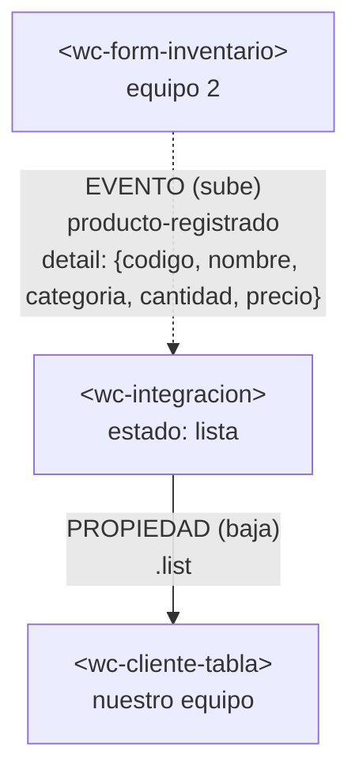

# Integración con el componente de otro equipo

## 1. Datos

| Campo | Valor |
|---|---|
| Equipo | Equipo 1 · Grupo 1 · Gestión de clientes |
| Equipo externo | Equipo 2 · Grupo 2 · Inventario |
| Repositorio externo | https://github.com/DaniAleG/app-lit |
| Archivo externo | `src/views/inventario/form-inventario.js` → copiado en `src/externos/equipo-2/form-inventario.js` |
| Commit usado | `1c8417f` |

## 2. Componentes y roles

| Componente | Archivo | Origen | Rol |
|---|---|---|---|
| `<wc-integracion>` | `src/views/integracion/integracion.js` | Nuestro equipo | **Padre**. Dueño del estado `lista`. |
| `<wc-form-inventario>` | `src/externos/equipo-2/form-inventario.js` | Equipo 2 | **Hijo**. Emite el evento `producto-registrado`. |
| `<wc-cliente-tabla>` | `src/components/clientes/cliente-tabla.js` | Nuestro equipo | **Hijo**. Recibe la lista por la propiedad `list`. |

## 3. Flujo de comunicación

Los datos bajan por propiedades y los eventos suben. El formulario del Equipo 2 no conoce la tabla; solo avisa con un evento y `<wc-integracion>` decide qué hacer con el dato.
